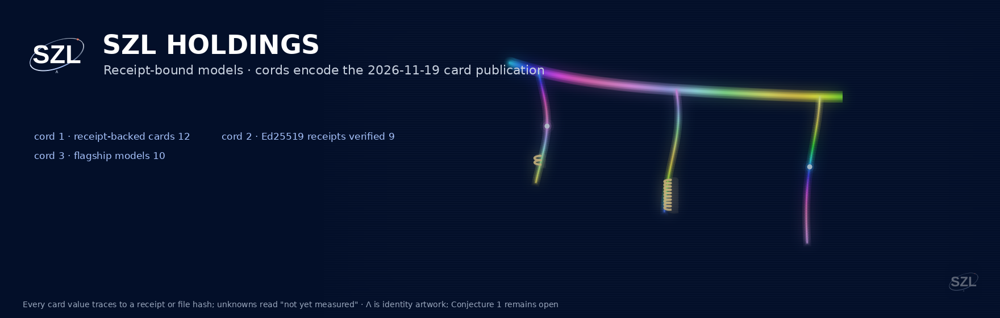

<!--szl.hf-card-source-binding/v1{"schema":"szl.hf-card-source-binding/v1","repository":"https://github.com/szl-holdings/.github","path":"huggingface/org-card","path_kind":"tree-dir-match","revision":"b9ac82d74324324273e13da74bc60eb95400a092","revision_basis":"bound-at-pinned-source-revision","head_at_binding":"b9ac82d74324324273e13da74bc60eb95400a092","hf_revision_at_binding":"02aae1512c1abae355018df2939460b753973ea9","binding_basis":"publisher-workflow","bound_at":"2026-11-19","bound_by":"Tinkuy\u0020118f2a5e\u0020(GitHub\u0020szl-holdings\u0020is\u0020source\u0020of\u0020truth)"}-->

<!-- markdownlint-disable MD013 MD033 MD041 -->

# Governed intelligence. Receipted evidence. Checkable results.

Source-traceable research software; every claim is evidenced or limited.

[Command](https://huggingface.co/spaces/SZLHOLDINGS/a11oy) · [Hub](https://huggingface.co/SZLHOLDINGS) · [Evidence](https://a11oy.net) · [Product](https://a-11-oy.com) · [Source](https://github.com/szl-holdings)

## Flagships

Control first, evidence after.

- **[A11oy](https://a-11-oy.com)** — governed product.
- **[Forge](https://github.com/szl-holdings)** — models, kernels, datasets, tooling.
- **[Killinchu](https://huggingface.co/spaces/SZLHOLDINGS/killinchu)** — automation body; public effectors **SIMULATED**.

## Pushing the frontier

[Ring-0 compute receipts](https://huggingface.co/datasets/SZLHOLDINGS/frontier-54-runs) · [x402-metered inference](https://inference.a-11-oy.com) · [checkable estate math](https://github.com/szl-holdings/lutar-lean).

## Live surfaces

- [**Receipts**](https://szlholdings-readme.static.hf.space/evidence.html) — hash-chained records.
- [**Diagrams**](https://a11oy.net/diagrams/) — provenance topology.
- [**Router source**](https://github.com/szl-holdings/szl-router) — OpenAI-compatible gateway.

## Repeat a public calculation

[Input and hash](https://github.com/szl-holdings/governed-receipt-spec/tree/320983d22e76fc9b26af0b2cd20799c5000543fc/examples/public-single-cell#public-data-and-attribution) [Executed code](https://github.com/szl-holdings/governed-receipt-spec/blob/160e39b1383a0e249399b6dfb72983b67aef7fe8/examples/public-single-cell/run_example.py) [Limits](https://github.com/szl-holdings/governed-receipt-spec/tree/320983d22e76fc9b26af0b2cd20799c5000543fc/examples/public-single-cell#outputs-and-verification-boundary)

GEO GSE85241: integrity and repeatability; unsigned receipt; no clinical claim.

## Choose a path

- **Use:** [A11oy](https://a-11-oy.com).
- **Build:** [models, kernels, datasets and Spaces](https://huggingface.co/SZLHOLDINGS).
- **Verify:** [records](https://a11oy.net), [diagrams](https://a11oy.net/diagrams/).

## Inference flagship

<!-- SZL_LLM_ROUTER_FLAGSHIP:BEGIN -->
[SZL Router](https://github.com/szl-holdings/szl-router) exposes an OpenAI-compatible gateway. [Status](https://huggingface.co/spaces/SZLHOLDINGS/llm-router-live) · [A11oy integration](https://a-11-oy.com/code) · [Route map](https://raw.githubusercontent.com/szl-holdings/.github/main/profile/assets/hf-card-router.svg). Provider availability requires separate evidence.
<!-- SZL_LLM_ROUTER_FLAGSHIP:END -->

## Current state

<!-- szl:public-inventory:start -->
The source-bound public inventory records **22 public Spaces, 121 model repositories, 14 native kernels, 69 datasets** at **2026-11-15T03:48:57Z** under `hf-public-author-membership/v2`. This is a dated observation, not a live count. Native kernel IDs may also appear in the model namespace; these figures do not count unique projects or trained language models. [Inventory binding](https://github.com/szl-holdings/.github/blob/main/profile/public-inventory.json) · [Exact source](https://github.com/szl-holdings/a11oy/blob/177fc4d95ed45ad88e3c7f1db09ea8b76763e82a/docs/huggingface-ecosystem-manifest.json) · [Current Hub listing](https://huggingface.co/SZLHOLDINGS). Hub inventory is registry evidence, not availability, operational readiness, or publication policy. It does not establish model quality.
<!-- szl:public-inventory:end -->

**HISTORICAL** alignment v1 recorded 16 portfolio Spaces, 1 inventory-only Space, 45 models, 34 datasets; the [legacy dataset](https://huggingface.co/datasets/SZLHOLDINGS/SZLHOLDINGS) is not readiness evidence.

Reproduction and provenance

[Architecture](https://huggingface.co/spaces/SZLHOLDINGS/README/resolve/main/assets/estate-command-system.svg). [Estate mark](assets/szl-mark-holographic.svg).

[`deployment.json`](https://szlholdings-readme.static.hf.space/deployment.json) records the source revision; compare with the [publisher manifest](https://github.com/szl-holdings/.github/blob/main/huggingface/org-card.manifest.json). A signature proves origin, never accuracy.

Reproduce with `python .github/scripts/hf_static_space_deploy.py --manifest huggingface/org-card.manifest.json --materialize preview_dir`; serve with `python -m http.server 8000`.

Roles: Three commercial flagships — A11oy, Killinchu, Forge; One inference flagship — SZL Router; Five public domain bodies — Terra, Killinchu, PRISM Counsel, PURIQ Finance, LYTE; Six internal engines — CHAPAQ, Lyte, Killinchu, Finance, Terra, Counsel.

