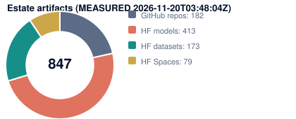
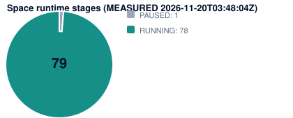
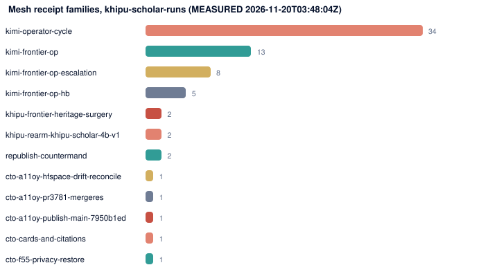

# SZL estate at a glance — measured 2026-11-20T03:48:04Z

This is a **dated inventory and runtime-stage observation**, not proof of trained models, production availability, training permission, safety, or settled revenue. Counts may have changed after capture. Source: [estate-cards audit](https://github.com/szl-holdings/estate-cards/blob/main/data/audit-latest.json) and [provenance records](https://github.com/szl-holdings/estate-cards/blob/main/PROVENANCE.md).

- **182 GitHub repositories** observed in the organization.
- **413 Hugging Face models, 173 datasets and 79 Spaces** observed in the namespace.
- **78 Spaces labeled RUNNING**, one not RUNNING, at the recorded runtime probe; RUNNING is not quality or endpoint proof.
- **141 receipt files** observed in the khipu-scholar-runs mesh ledger.
- One governance dataset was private; namespace counts are not a public-artifact count.

Source-owned [estate-cards](https://github.com/szl-holdings/estate-cards) generates these SVGs. [Rollout receipts](https://github.com/szl-holdings/estate-cards/blob/main/rollout_receipts.jsonl) record actual card-publication attempts; they do not establish every card as deployed or healthy.

## Historical context

**HISTORICAL:** Three commercial flagships, one inference flagship, six internal engines, **Five public domain bodies** (Terra; PRISM Counsel; PURIQ Finance; LYTE). Earlier snapshot: 16 portfolio Spaces, 1 inventory-only Space, 45 models, 34 datasets. Hub listings do not establish deployment, capability, quality or publication policy.

[Back to the organization profile](README.md).
