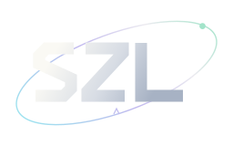
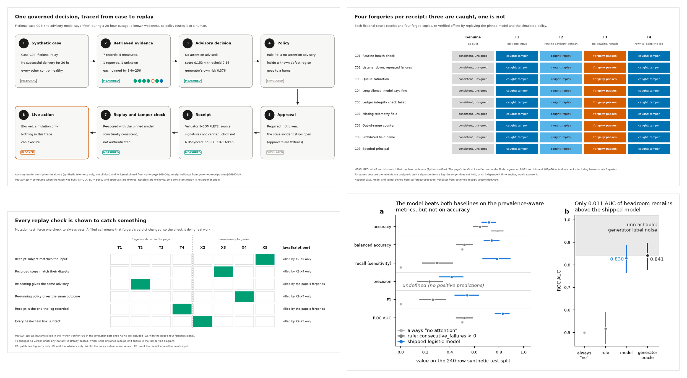

# Governed intelligence. Checkable results.

SZL Holdings builds AI software, models and research tools that connect an output to its source and evidence. Inspect what is available; reproduce the work behind each claim.

[**Explore Command Lab →**](https://huggingface.co/spaces/SZLHOLDINGS/szl-command-lab) · [**Build with the source →**](https://github.com/szl-holdings)

## Repeat a public calculation

[Repeat a public calculation](https://github.com/szl-holdings/governed-receipt-spec/tree/320983d22e76fc9b26af0b2cd20799c5000543fc/examples/public-single-cell) — input → code → result → limits

Receipt unsigned; no biological claim.

## Choose a path

- **Explore:** [Command Lab](https://huggingface.co/spaces/SZLHOLDINGS/szl-command-lab) — the searchable portfolio.
- **Use:** [A11oy](https://a-11-oy.com) — tools with live capability state.
- **Build:** [models, kernels, datasets, Spaces](https://huggingface.co/SZLHOLDINGS) · [PyPI packages](https://pypi.org/user/betterwithage/).
- **Verify:** [a11oy.net](https://a11oy.net) — records, limits, [evidence diagrams](https://a11oy.net/diagrams/).

## What we build

**A11oy** connects governed workflows; **[SZL Router](https://github.com/szl-holdings/szl-router)** routes model requests through [A11oy Code](https://a-11-oy.com/code) with a [status surface](https://huggingface.co/spaces/SZLHOLDINGS/llm-router-live). **Killinchu** demonstrates public observation; effectors remain **SIMULATED**. **Forge** houses model and software research.

A published file, running application and independently checked result establish different things. Each artifact needs its own evidence and use limits.

## The flagship estate

- **a11oy** — governed runtime, x402 APIs · [a-11-oy.com](https://a-11-oy.com)
- **Living Anatomy** — the anatomy engine · [Space](https://szlholdings-anatomy.hf.space)
- **Second Brain** — the memory plane · [Space](https://huggingface.co/spaces/SZLHOLDINGS/szl-second-brain)
- **hatun-mcp** — production MCP · [repo](https://github.com/szl-holdings/hatun-mcp)
- **killinchu** — counter-UAS · [killinchu.a-11-oy.com](https://killinchu.a-11-oy.com)

## Measured: the confabulation floor

6-probe battery, every failure published — [receipts](https://huggingface.co/datasets/SZLHOLDINGS/model-eval-receipts).

- Estate students 0.8B–4B: 0–2/6 FAIL · Qwen3-8B/14B: 1/6 FAIL
- Copy-constrained decoding: 21.9% capture — 16× the floor
- Claude Sonnet 4.5: 5/6 PASS — first in the arc

**The law:** the floor is an alignment property expressed through decoding — training and scale do not move it; constrained decoding moves it 16×; frontier alignment clears it. [P8](https://doi.org/10.5281/zenodo.24043620) · [P9](https://doi.org/10.5281/zenodo.24043622).

## Current state

<!-- szl:public-inventory:start -->
Dated observation, not a live count. [Inventory binding](https://github.com/szl-holdings/.github/blob/main/profile/public-inventory.json) · [Hub listing](https://huggingface.co/SZLHOLDINGS). Registry evidence only — not readiness or quality.
<!-- szl:public-inventory:end -->

**HISTORICAL:** estate-alignment v1 described 16 portfolio Spaces, 1 inventory-only Space, 45 models, and 34 datasets. The [`SZLHOLDINGS/SZLHOLDINGS` dataset](https://huggingface.co/datasets/SZLHOLDINGS/SZLHOLDINGS) is a historical profile mirror. It does not establish today's inventory, readiness, or model quality.

Reproduce an example and inspect the architecture

[Architecture image](./assets/evidence-lattice-v2.webp) · [Authorization rules](https://github.com/szl-holdings/.github/blob/main/TRUST.md)

### Portfolio roles

- **Three commercial flagships:** A11oy, Killinchu, Forge.
- **One inference flagship:** SZL Router.
- **Five public domain bodies:** Terra, Killinchu, PRISM Counsel, PURIQ Finance, LYTE.
- **Six internal engines:** CHAPAQ (folded into Killinchu), Lyte, Killinchu, Finance, Terra, Counsel.

These are architecture roles. Inspect each artifact's source and stated use limits before choosing a use.

Measured runtime snapshot: [full audit](../docs/LIVING_SOULS_INFRASTRUCTURE_AUDIT_2026-10-17.md).
